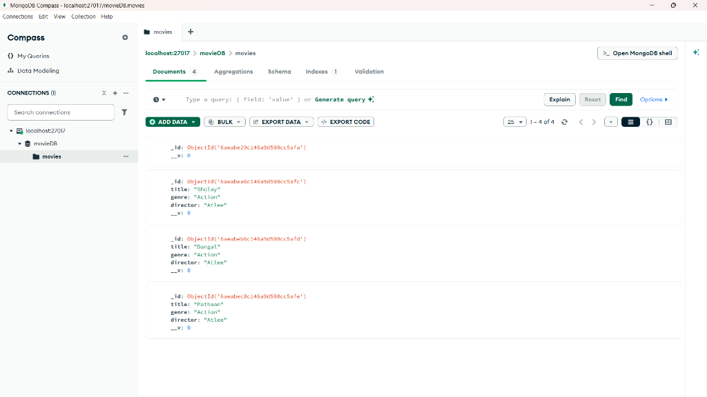
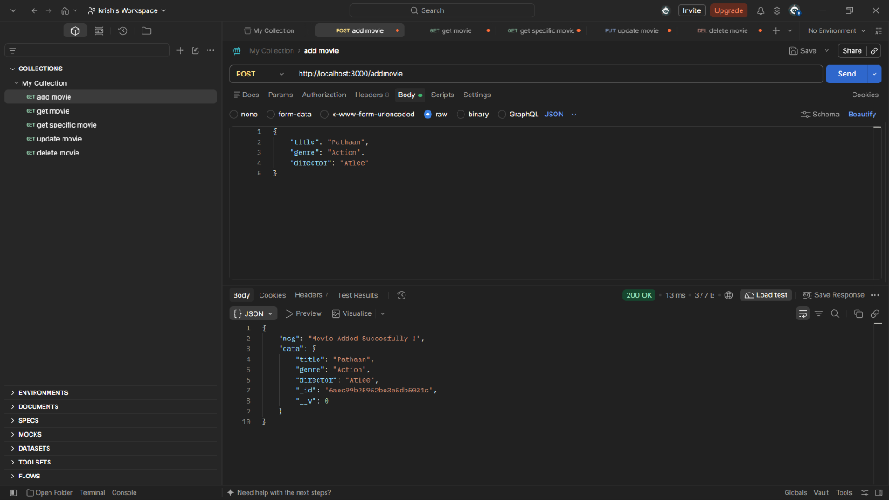
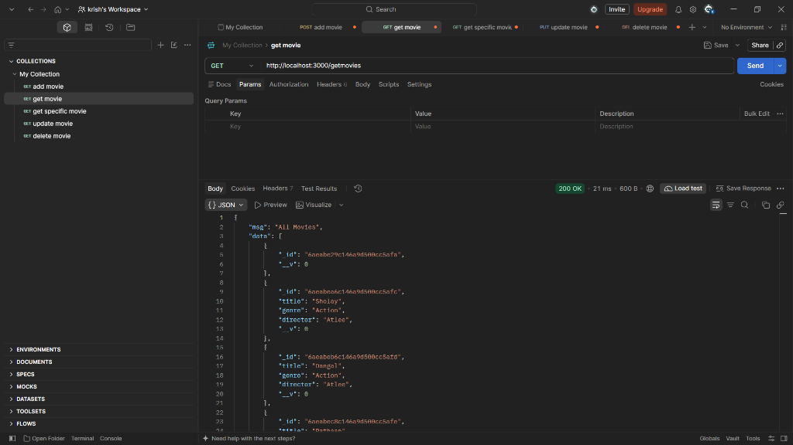
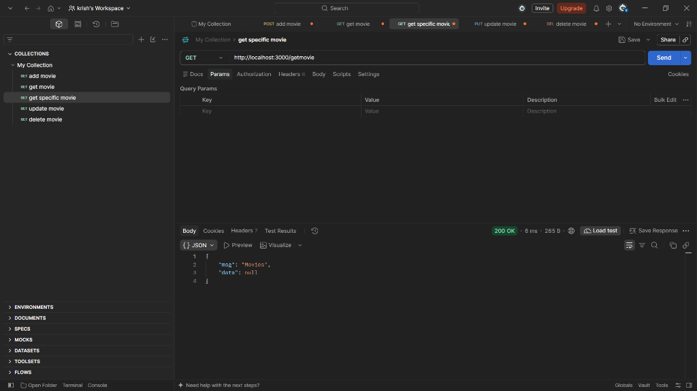
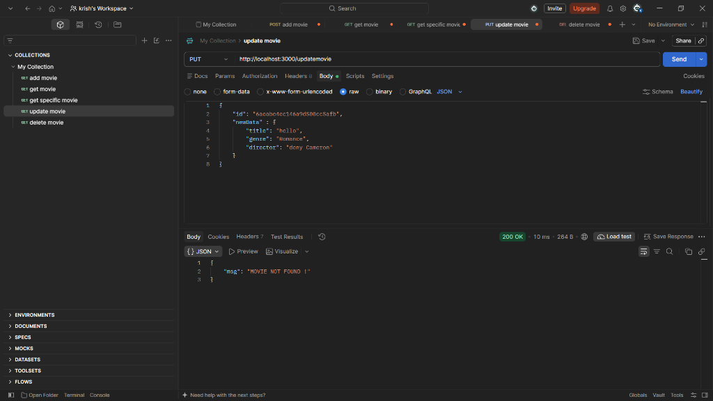
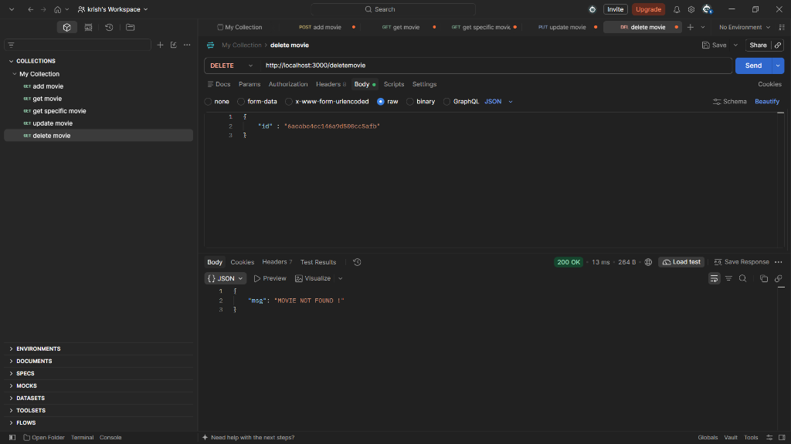

# 🎬 Movie Management REST API (MongoDB & Express)

A lightweight and fast RESTful API built with **Node.js**, **Express.js**, and **MongoDB (Mongoose)** for managing movie records (CRUD operations).

---

## 📁 Project Structure

```text
mongodb_project/
├── screenshots/          # Output and Postman/Compass test screenshots
│   ├── mongodb_compass.png
│   ├── post_addmovie.png
│   ├── get_allmovies.png
│   ├── get_specificmovie.png
│   ├── put_updatemovie.png
│   └── delete_movie.png
├── node_modules/         # Installed npm packages and dependencies
├── app.js               # Main application entry point, DB connection, models, & API routes
├── package.json         # Project metadata, scripts, and dependency list
├── package-lock.json    # Exact versions of installed dependencies
└── README.md            # Project documentation and API reference
```

---

## 🚀 Tech Stack

- **Runtime Environment:** [Node.js](https://nodejs.org/) (ES Modules)
- **Framework:** [Express.js](https://expressjs.com/) (v5)
- **Database:** [MongoDB](https://www.mongodb.com/)
- **ODM (Object Data Modeling):** [Mongoose](https://mongoosejs.com/)
- **API Testing:** [Postman](https://www.postman.com/)
- **GUI Database Client:** [MongoDB Compass](https://www.mongodb.com/products/compass)
- **Development Tool:** [Nodemon](https://nodemon.io/) (Hot-reloading server)

---

## ⚙️ Prerequisites

Make sure you have the following installed on your machine:
- [Node.js](https://nodejs.org/) (v16+ recommended)
- [MongoDB Community Server](https://www.mongodb.com/try/download/community) and [MongoDB Compass](https://www.mongodb.com/products/compass)
- [Postman](https://www.postman.com/) or [Thunder Client](https://www.thunderclient.com/) for API testing

---

## 🛠️ Installation & Setup

1. **Clone or Navigate to the Project Directory:**
   ```bash
   cd mongodb_project
   ```

2. **Install Dependencies:**
   ```bash
   npm install
   ```

3. **Ensure MongoDB is Running:**
   - Default connection URL: `mongodb://127.0.0.1:27017/movieDB`
   - Start MongoDB service locally or open MongoDB Compass and connect to `localhost:27017`.

4. **Start the Server:**
   - **For Development (Auto-restart on code change):**
     ```bash
     npm run dev
     ```
   - **For Normal Start:**
     ```bash
     node app.js
     ```

5. **Server Status:**
   - Server runs on: `http://localhost:3000`
   - Console will output:
     ```text
     MongoDB Connected
     ```

---

## 🗄️ Database Model (Schema)

The `movie` collection schema is defined as:

```javascript
{
  title: String,      // Movie title (e.g., "Pathaan", "Sholay")
  genre: String,      // Genre (e.g., "Action")
  director: String    // Director name (e.g., "Atlee")
}
```

### 🧭 MongoDB Compass Data View


---

## 📡 API Endpoints & Testing

Base URL: `http://localhost:3000`

### 1. Root / Health Check
- **Endpoint:** `GET /`
- **Description:** Verifies that the API server is active.
- **Response:**
  ```json
  {
    "msg": "Home Page"
  }
  ```

---

### 2. Add Movie (POST)
- **Endpoint:** `POST /addmovie`
- **Headers:** `Content-Type: application/json`
- **Request Body:**
  ```json
  {
    "title": "Pathaan",
    "genre": "Action",
    "director": "Atlee"
  }
  ```
- **Response:**
  ```json
  {
    "msg": "Movie Added Succesfully !",
    "data": {
      "title": "Pathaan",
      "genre": "Action",
      "director": "Atlee",
      "_id": "6aec99b25952be3e5db5031c",
      "__v": 0
    }
  }
  ```
- **Screenshot:**
  

---

### 3. Get All Movies (GET)
- **Endpoint:** `GET /getmovies`
- **Description:** Fetches all movies stored in the `movieDB.movies` collection.
- **Response:**
  ```json
  {
    "msg": "All Movies",
    "data": [
      {
        "_id": "6aeabe29c146a9d500cc5afa",
        "__v": 0
      },
      {
        "_id": "6aeabea6c146a9d500cc5afc",
        "title": "Sholay",
        "genre": "Action",
        "director": "Atlee",
        "__v": 0
      },
      {
        "_id": "6aeabeb6c146a9d500cc5afd",
        "title": "Dangal",
        "genre": "Action",
        "director": "Atlee",
        "__v": 0
      },
      {
        "_id": "6aeabec8c146a9d500cc5afe",
        "title": "Pathaan",
        "genre": "Action",
        "director": "Atlee",
        "__v": 0
      }
    ]
  }
  ```
- **Screenshot:**
  

---

### 4. Get Specific Movie (GET)
- **Endpoint:** `GET /getmovie`
- **Description:** Finds a single movie (searches for `{ title: "Jawan" }`).
- **Response (When movie is not present):**
  ```json
  {
    "msg": "Movies",
    "data": null
  }
  ```
- **Screenshot:**
  

---

### 5. Update Movie (PUT)
- **Endpoint:** `PUT /updatemovie`
- **Headers:** `Content-Type: application/json`
- **Request Body:**
  ```json
  {
    "id": "6acabc4cc146a9d500cc5afb",
    "newData": {
      "title": "hello",
      "genre": "Romance",
      "director": "deny Cameron"
    }
  }
  ```
- **Response (When ID is not found):**
  ```json
  {
    "msg": "MOVIE NOT FOUND !"
  }
  ```
- **Screenshot:**
  

---

### 6. Delete Movie (DELETE)
- **Endpoint:** `DELETE /deletemovie`
- **Headers:** `Content-Type: application/json`
- **Request Body:**
  ```json
  {
    "id": "6acabc4cc146a9d500cc5afb"
  }
  ```
- **Response (When ID is not found):**
  ```json
  {
    "msg": "MOVIE NOT FOUND !"
  }
  ```
- **Screenshot:**
  

---

## 📸 Output & Testing Gallery

| Output / Test | Screenshot |
| :--- | :--- |
| **MongoDB Compass Collection** |  |
| **POST `/addmovie`** |  |
| **GET `/getmovies`** |  |
| **GET `/getmovie`** |  |
| **PUT `/updatemovie`** |  |
| **DELETE `/deletemovie`** |  |

---

## video link

https://drive.google.com/file/d/1xfP-U5cwNpvPBXEmOgn7VbZkSfpzBKyi/view?usp=sharing

## 💡 Recommended Future Improvements

- [ ] **RESTful URL Parameters:** Change endpoints to standard REST conventions:
  - `GET /movies/:id` instead of hardcoded title search
  - `PUT /movies/:id` instead of sending ID in body
  - `DELETE /movies/:id` instead of sending ID in body
- [ ] **Environment Variables:** Use `dotenv` to store `PORT` and `MONGO_URI` securely.
- [ ] **HTTP Status Codes:** Return standard codes like `201 Created`, `404 Not Found`, `500 Internal Server Error`.
- [ ] **Folder Refactoring:** Organize the project into MVC architecture (`controllers/`, `routes/`, `models/`, `config/`).
